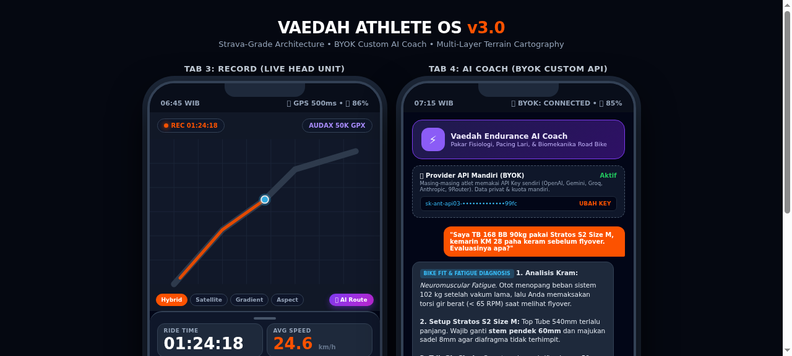
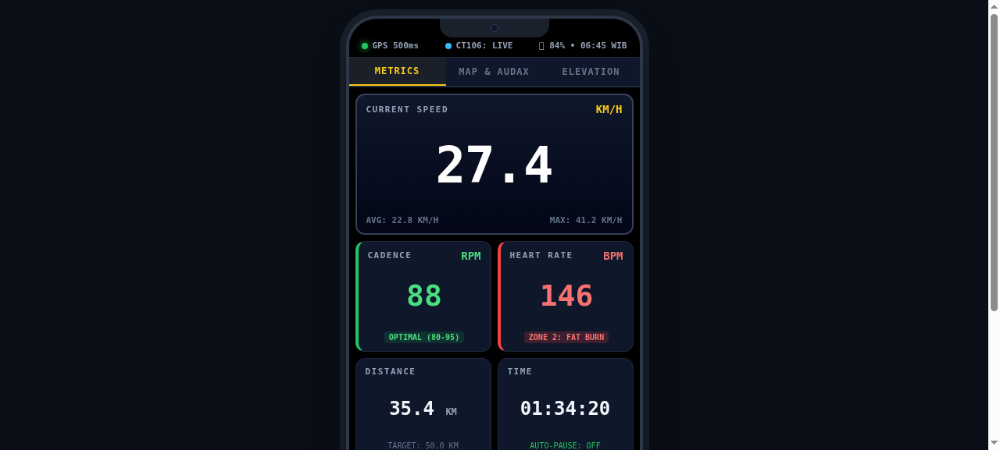

<div align="center">


### **The Smart Endurance Companion — Ride & Run**
*Modern, Offline-First Android Head Unit & Telemetry Tracker with BYOK AI Coach*

[](https://github.com/agentvaedah/strideway/actions/workflows/android.yml)
[](https://kotlinlang.org)
[](https://developer.android.com)
[](LICENSE)
[]()

<br/>



</div>

---

## 🌟 Sekilas Strideway

**Strideway** (`id.web.agentvaedah.strideway`) adalah aplikasi Android native yang dirancang khusus sebagai **Dedicated Cycling Head Unit / Computer & Endurance Tracker**. Dirancang dengan filosofi **100% Offline-First**, aplikasi ini mengubah smartphone Android (seperti Nokia 5.3) menjadi komputer sepeda tangguh yang tahan getaran, presisi, dan hemat daya di jalan raya tanpa ketergantungan sinyal internet.

---

## ✨ Fitur Unggulan (v0.4)

### 🚴‍♂️ 1. Cockpit & Telemetri Real-Time
* **Dual Multi-Sensor BLE Hub:** Dukungan otomatis koneksi Bluetooth Low Energy GATT ke *Heart Rate Broadcast* (misal: Huawei Band 11 Pro / Chest Strap `0x180D`) dan *Cadence/Speed Sensor* (misal: XOSS / Magene S3+ `0x1816`).
* **Presisi Formula Fisiologi (BB Dinamis):** Perhitungan kalori dan beban latihan presisi berdasarkan formula **Keytel 2005** yang disesuaikan dengan bobot atlet (90 kg) dan riwayat denyut jantung.
* **Auto-Pause & IMU Dead Reckoning:** Menggabungkan GPS raw polling (500ms) dengan akselerometer internal ponsel saat melintasi terowongan atau sinyal GPS drop.
* **Standby HUD Pre-Ride:** Layar diagnostik untuk memverifikasi akurasi satelit GPS dan sinyal sensor BLE sebelum gowes dimulai.

### 🗺️ 2. Navigasi & Peta 3D Multi-Layer
* **Turn-by-Turn NavBanner:** Panduan arah panah dinamis, penghitung mundur jarak belokan (*countdown* meter), nama jalan, dan deteksi otomatis saat melenceng dari rute (*Off-route alert*).
* **MapLibre Offline Engine:** Peta vektor interaktif dengan kontrol kemiringan 3D (*Tilt*), mode *Heading-Up*, dan layer topografi/elevasi.
* **GPX / TCX / FIT Route Follower:** Import dan ikuti rute gowes jalan raya (Audax, fondo, CFD) dengan visualisasi jalur elevasi.

### 🤖 3. BYOK AI Coach (Bring Your Own Key)
* **AI Pelatih Pribadi Terintegrasi:** Analisis cerdas pasca-gowes, saran pemulihan otot, dan strategi hidrasi/nutrisi menggunakan model AI pilihan Anda.
* **Dukungan Provider:** OpenAI (GPT-4o), Google Gemini, Anthropic Claude, Groq, serta local LLM proxy (9Router / Ollama).
* **Keamanan Kunci:** API Key disimpan terenkripsi di dalam **Android Keystore (Hardware-backed)** pada perangkat lokal.

### 📊 4. Training, Gear & Social Share
* **Latihan Terstruktur & FTP:** Manajemen sesi interval latihan (*Workout Library*) berdasarkan nilai daya kayuh ambang batas (*Functional Threshold Power*).
* **Garage & Gear Mileage Tracker:** Pantau keausan komponen sepeda (rantai, ban luar Entity 700x28c Polygon Strattos S2) atau masa pakai sepatu lari.
* **Social Share Cards:** Ekspor kartu ringkasan visual aktivitas (grafik elevasi, split kecepatan, heart rate) dengan tipografi modern untuk media sosial.

---

## 📱 Tangkapan Layar & Mockup

<div align="center">

| Head Unit Cockpit (Nokia 5.3) | Strava-Style Drawer & 3D Map |
|:---:|:---:|
|  |  |

</div>

---

## 🏗️ Arsitektur & Teknologi

* **Bahasa:** 100% Kotlin Native
* **UI Framework:** Jetpack Compose & Material 3
* **Dependency Injection:** Dagger Hilt
* **Database Lokal:** Android Room (SQLite) dengan skema migrasi otomatis
* **Pemetaan:** MapLibre Native Compose SDK
* **Font & Brand:** Strideway Sans Bold Italic & Outfit Display
* **Modul `:core`:** Pure Kotlin/JVM Library (bebas dependensi Android framework) — siap untuk migrasi Kotlin Multiplatform (KMP).

---

## 🚀 Cara Build & Kompilasi

### Prasyarat
* Android Studio Ladybug (2024.2+) atau Android SDK Command-line Tools v12.0+
* OpenJDK 17
* Android SDK Platform API 34 & Build-Tools 34.0.0

### Langkah Build Manual (CLI)
```bash
# 1. Jalankan Unit Test Modul Inti (89 Tests)
./gradlew :core:test

# 2. Kompilasi Debug APK
./gradlew :app:assembleDebug

# 3. Hasil Build APK akan berada di:
# app/build/outputs/apk/debug/app-debug.apk
```

### Auto-Build Cloud (GitHub Actions)
Repository ini telah dilengkapi CI workflow otomatis. Setiap push kode baru akan di-test dan di-compile menjadi APK yang siap diunduh di tab [**Actions**](https://github.com/agentvaedah/strideway/actions).

---

## 📄 Lisensi

Didistribusikan di bawah lisensi **MIT License**. Lihat file [`LICENSE`](LICENSE) untuk informasi lebih lanjut.
