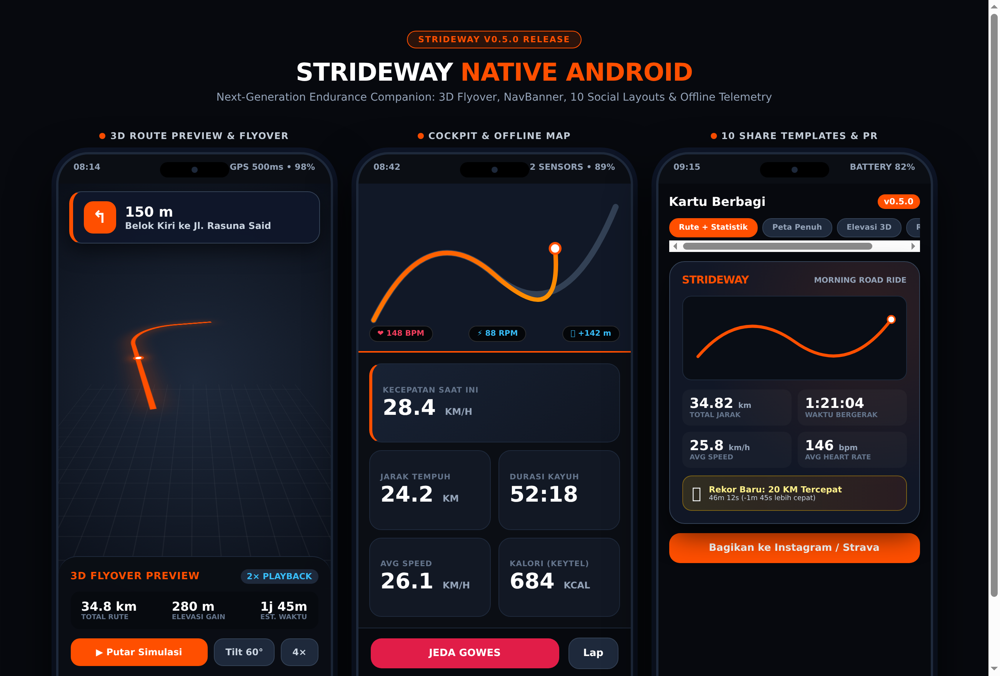
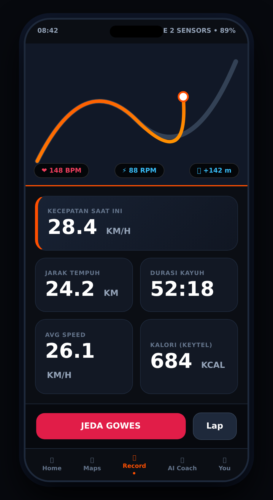

<div align="center">

<picture>
  <source media="(prefers-color-scheme: dark)" srcset="assets/branding/strideway-lockup-color-dark.svg">
  <source media="(prefers-color-scheme: light)" srcset="assets/branding/strideway-lockup-color-light.svg">
  
</picture>

<br/>

### **The Smart Endurance Companion — Ride & Run**
*Modern, Offline-First Android Head Unit & Telemetry Tracker with BYOK AI Coach*

[](https://github.com/agentvaedah/strideway/actions/workflows/android.yml)
[](https://kotlinlang.org)
[](https://developer.android.com)
[](https://developer.android.com/jetpack/compose)
[]()
[]()
[](LICENSE)

<br/>



</div>

---

## 📖 Tentang Strideway

**Strideway** (`id.web.agentvaedah.strideway`) adalah aplikasi Android native yang dibangun dari nol untuk berfungsi sebagai **Komputer Sepeda Tangguh (Dedicated Cycling Head Unit)** dan **Pelacak Olahraga Ketahanan (Endurance Tracker)**. Dirancang khusus dengan prinsip dasar **100% Offline-First**, Strideway mengubah smartphone Android (seperti Nokia 5.3) menjadi head unit stang sepeda profesional: presisi tinggi, tahan getaran ban tekanan tinggi (85–95 PSI), hemat baterai, dan mandiri tanpa ketergantungan koneksi internet maupun cloud pihak ketiga.

Proyek ini menggabungkan telemetry cockpit real-time, navigasi peta 3D offline, integrasi sensor Bluetooth Low Energy (BLE), pustaka latihan daya kayuh (FTP), hingga pelatih cerdas **BYOK AI Coach (Bring Your Own Key)** yang berjalan aman di perangkat.

---

## 🎨 Identitas & Filosofi Brand

<div align="center">

| App Icon (Adaptive Octagon) | Wordmark (Track Accent) |
|:---:|:---:|
|  |  |

</div>

Brand Strideway dibangun dengan identitas visual yang tegas, fungsional, dan sarat makna olahraga ketahanan:

* **Etimologi Nama:** 
  * **Stride** *(Langkah)* mewakili dinamika, ritme, dan langkah kaki pelari.
  * **Way** *(Jalan / Rute)* mewakili jalur aspal, tanjakan, dan lintasan yang diarungi pesepeda.
* **Segi Delapan Bersudut 45° (Octagonal Tyre Ring):** Lingkaran luar ikon merepresentasikan ban sepeda kokoh yang berputar. Dibuat dengan sudut potong tegas tanpa kurva lembut untuk mencerminkan ketangguhan mekanikal.
* **Huruf S di Poros Roda:** Inisial *S* terletak tepat di pusat sumbu layaknya *hub* atau as roda, berlekuk tajam menyerupai kelokan jalan menanjak (*switchback* rute pegunungan).
* **Kemiringan Aerodinamis 12°:** Seluruh elemen logo, ikon, dan tipografi dimiringkan 12° ke depan (*slanted forward*) untuk menyimbolkan akselerasi, momentum, dan kecepatan.
* **Warna Signal Orange (`#FF4F00`):** Terinspirasi dari rompi keselamatan *high-visibility* pesepeda jalan raya. Warna ini mencolok di bawah terik matahari, kontras di atas peta gelap, dan memancarkan energi denyut jantung tinggi.
* **Warna Ink Black (`#0A0A0B`) & Clean White (`#FFFFFF`):** Memberikan kontras rasio tinggi (WCAG AAA) sehingga metrik di layar tetap terbaca jelas dalam sekali lirik saat melaju kencang.

---

## 🚀 Fitur Unggulan (v0.5.0)

### 🗺️ 1. Peta Navigasi & Pratinjau 3D (*New in v0.5.0*)
* **3D Route Flyover Camera:** Fitur simulasi rute sebelum gowes dimulai. Kamera menyusuri jalur GPX secara otomatis dengan kemiringan (*tilt*) 60°, kendali rotasi bebas, serta akselerasi putar 2× hingga 4× lengkap dengan banner belokan aktif.
* **Turn-by-Turn NavBanner:** Panduan arah belokan dinamis di kokpit, penghitung mundur jarak belokan (*countdown* meter presisi), nama jalan, dan peringatan instan saat keluar rute (*off-route alert*).
* **MapLibre Native Offline Engine:** Render peta vektor luring (*offline vector tiles*) yang halus, hemat RAM, dan mendukung mode *Heading-Up* mengikuti kompas sepeda.
* **Cue Sheet Lengkap:** Akses daftar lengkap rute belokan navigasi turn-by-turn langsung dari layar peta sebelum merekam.

### 🚴‍♂️ 2. Cockpit Telemetri Real-Time
* **BLE Multi-Sensor Hub:** Auto-connect instan via Bluetooth Low Energy GATT standar untuk:
  * **Heart Rate Broadcast (`0x180D`):** Huawei Band 11 Pro, Garmin HRM, Magene, Polar, atau chest strap.
  * **Cadence & Speed Sensor (`0x1816`):** Sensor crank & wheel hub (XOSS, Magene S3+, dsb.).
* **Kalkulasi Kalori Presisi (Keytel 2005):** Algoritma pembakaran kalori berbasis denyut jantung aktual yang disesuaikan dengan bobot tubuh dinamis atlet (90 kg).
* **IMU Dead Reckoning & Auto-Pause:** Mengombinasikan raw GPS polling (500ms) dengan akselerometer internal ponsel saat melewati flyover, terowongan, atau area *GPS shadow*.

### 📱 3. Berbagi Aktivitas & Catatan Rekor (*New in v0.5.0*)
* **10 Template Kartu Media Sosial:** Ekspor ringkasan gowes langsung dari layar aplikasi ke media sosial dengan latar belakang peta satelit/topografi asli, grafik elevasi, split kecepatan, dan zona denyut jantung.
* **Mini Peta Asli di Kartu Riwayat:** Layar Home dan Profil menampilkan thumbnail snapshot peta rute sesungguhnya (*live map raster snapshot*), bukan sekadar garis vektor hampa.
* **Personal Records (PR) ala Strava:** Pelacakan otomatis pencapaian terbaik (*Best Efforts*) untuk kategori 1 km, 5 km, 10 km, hingga 40 km lengkap dengan lencana medali dan selisih waktu rekor lama.

### 🤖 4. BYOK AI Coach (Bring Your Own Key)
* **Pelatih AI Pribadi di Saku:** Analisis cerdas sesi latihan pasca-gowes, deteksi kelelahan neuromuskular (misal: analisis kram otot di KM 28), saran hidrasi elektrolit, dan rekomendasi hari istirahat berdasarkan data tidur smartwatch.
* **Multi-Provider Dukungan:** OpenAI (GPT-4o), Google Gemini, Anthropic Claude, Groq, serta Local LLM Gateway pribadi ([9Router](https://github.com/decolua/9router) / Ollama).
* **Hardware-Backed Security:** Kunci API pengguna disimpan secara aman di dalam **Android Keystore**, tidak pernah diunggah ke server mana pun.

### 🔧 5. Garasi & Pelacak Jarak Tempuh Komponen
* **Garage Gear Mileage:** Pantau masa pakai rantai, ban luar 700x28c, kampas rem sepeda balap (Polygon Strattos S2), atau sol sepatu lari agar pergantian part terjadwal sebelum terjadi kerusakan mekanis di jalan.

---

## 📱 Tampilan Antarmuka (Cockpit & Showcase)

<div align="center">

| Head Unit Cockpit (Nokia 5.3) | Strava-Style Analytics & 3D Route |
|:---:|:---:|
|  |  |

</div>

---

## 🏗️ Arsitektur Sistem & Spesifikasi Teknis

Aplikasi dibangun menggunakan pola arsitektur modern Android (Clean Architecture & MVI/MVVM):

```
strideway/
├── app/                  # Android Application Module (Jetpack Compose UI & Services)
│   ├── src/main/java/id/web/agentvaedah/strideway/
│   │   ├── ble/          # BLE GATT Client (Heart Rate & Cadence Collectors)
│   │   ├── location/     # Fused GPS Provider & Dead Reckoning Engine
│   │   ├── service/      # Foreground Recording Service (Wakelock & Notification)
│   │   ├── data/         # Room Database, DataStore, & Android Keystore BYOK
│   │   └── ui/           # Jetpack Compose Screens (Home, Maps, Record, Coach, You)
│   └── src/main/res/     # Resources, Vector Drawables, & Color Tokens
├── core/                 # Pure Kotlin/JVM Domain & Calculation Engine
│   ├── src/main/kotlin/  # Keytel 2005 Formula, GPX Parser, FTP Power Zones
│   └── src/test/kotlin/  # 89 Comprehensive Unit Tests (100% Passing)
├── assets/               # Branding Logos, Mockups, Motion Splash Assets
└── tools/                # Logo Generator & Automation Scripts
```

* **Bahasa Pemrograman:** Kotlin 2.0.21
* **Toolkit UI:** Jetpack Compose & Material Design 3
* **Arsitektur Dependency Injection:** Dagger Hilt 2.51.1
* **Penyimpanan Data:** Android Room 2.6.1 (SQLite) dengan migrasi otomatis
* **Mesin Pemetaan:** MapLibre Native Compose SDK v11
* **Target Platform:** Android 14 (API 34) — Kompatibel ke bawah hingga Android 8.0 (API 26)
* **Kesiapan Multiplatform:** Modul `:core` sepenuhnya independen dari Android Framework, siap untuk porting ke Kotlin Multiplatform (KMP).

---

## 🛠️ Panduan Kompilasi & Build

### Persyaratan Lingkungan
* **JDK:** OpenJDK 17 LTS
* **Android SDK:** Platform API 34 (`build-tools;34.0.0`)
* **Gradle:** Wrapper v8.11.1

### Perintah Build Terminal (CLI)
```bash
# 1. Jalankan pengujian unit test modul inti (:core)
./gradlew :core:test

# 2. Kompilasi aplikasi ke format APK Debug
./gradlew :app:assembleDebug

# 3. Lokasi berkas instalasi APK yang dihasilkan:
# app/build/outputs/apk/debug/app-debug.apk
```

### Otomasi CI/CD Cloud (GitHub Actions)
Setiap *commit* atau *pull request* yang didorong ke branch `main` akan memicu pipeline GitHub Actions secara otomatis untuk memvalidasi kode, menjalankan 89 unit test, serta merilis artefak APK yang dapat diunduh di tab [**Actions**](https://github.com/agentvaedah/strideway/actions).

---

## 📄 Lisensi

Proyek ini dilisensikan di bawah lisensi terbuka [MIT License](LICENSE).  
Dikelola dan dikembangkan oleh **Agent Vaedah** ([@agentvaedah](https://github.com/agentvaedah)).
